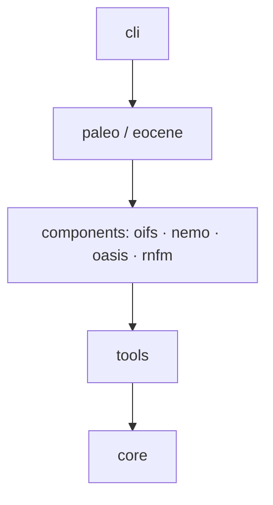

## Refactor: turn the repo into one `ecefast` package

> **Updated 2026-11-12.** The plan now follows the rules in [`AGENTS.md`](https://github.com/renatacoppo/Eocene-creator/blob/main/AGENTS.md) (merged in #17) and includes Renata's two comments below: both ocean initial files are built, and `plots.ipynb` replaces `modify_oifs.ipynb` and `modify_nemo.ipynb`. A second round of changes after a feasibility review (same day) is listed at the end.

### In short

We want to reorganise the repository into **one installable Python package, `ecefast`**. Generic tools that build EC-Earth4 input data for any grid go at the bottom. Everything Eocene-specific sits on top. The Eocene workflow becomes a single command that checks its inputs before starting, runs on a laptop and in CI, and needs the HPC only for the NEMO DOMAINcfg tool.

The refactor must **not change any result**. Before we start, we save the output of today's code as a reference, and every refactor pull request must reproduce it. There is one planned exception, agreed in advance: PR 5 adds subbasins for the Eocene domain (see the plan).

This issue explains why, shows what it will look like, and lists the steps. Comments are very welcome.

---

### Why: what is hard today

**1. Building the Eocene domain needs a manual hand-off.** Today the sequence is:

1. Edit the paths in `ecefast/nemo/nemo_workflow.yaml`.
2. Run `cli-domain-paleorca.py` on Atos. It builds both the present-day and the Eocene domain.
3. Copy `domain_cfg.nc` and `maskutil.nc` **by hand** to `ECE4-DATA-EOCENE/nemo/domain/PALEORCA2`.
4. Point `dirs.domain` in the `eocene` config to that folder.
5. Run `eocene`.

If step 3 is forgotten after rebuilding the domain, `eocene` uses the old domain and nothing warns us. The code that makes the Eocene bathymetry also lives inside the "generic" part (`ecefast/nemo/processors/eocene.py`), so it is not clear where Eocene work belongs.

**2. Missing files are found late.** Suppose `nemo/initial/woa13-levitus-L31.nc` is missing from the input folder. `eocene --run all` first runs OASIS and the whole OIFS part, which takes minutes and writes output. Then NEMO crashes with a Python traceback. We are left with a half-written output folder.

**3. The same code exists twice.** For example, `unpack_grib_file` and `repack_grib_file` are in both `ecefast/oifs/utils_oifs.py` and `eocene/oifs/utils.py`. `maskutil.nc` is written by two different functions. Fixing a bug in one copy leaves the other copy broken.

**4. Paths are written into the code.** `oifs_generator.py`, `run_domain_cfg.sh`, the weights namelists and `eocene/config.tmpl` point to personal home and project folders on the HPC. They only work for one person on one machine.

**5. There are no tests.** After any change we cannot tell whether the results moved.

---

### Rules every PR follows

The rules are in [`AGENTS.md`](https://github.com/renatacoppo/Eocene-creator/blob/main/AGENTS.md), for us and for coding agents. The ones that shape this plan:

- **Simple first.** The smallest design that works, a short learning curve, one copy of each piece of code, no options "for later".
- **Results do not move in a refactor.** The compare script must report 0 differences. A PR that *does* change results is allowed, but it says so, needs approval, and gets an *Output* entry in `CHANGELOG.rst`; the reference run is then redone.
- **Files look like the originals.** When we modify an EC-Earth file we keep, whenever possible, its NetCDF attributes, variable and dimension order, and its GRIB metadata and message order.
- **Tests come with the code.** Every new or changed function gets a unit test; every new step gets an integration test.
- **Docs and changelog come with the code.** Documentation is in reStructuredText (ready for Read the Docs later); every PR adds a line to `CHANGELOG.rst`.
- **No paths, host names, user names or secrets** in code, scripts, templates or notebooks. They come from the config, the command line or environment variables.
- **The other author reviews every PR.** The PR description says whether results change and which test groups ran.

---

### What it will look like for the user

One configuration file per machine, and a few commands:

```
ecefast eocene run -c configs/laptop.yml   # run the whole Eocene workflow
ecefast eocene run -c configs/laptop.yml --steps oifs,nemo   # only some parts
ecefast eocene run -c configs/laptop.yml --dry-run           # check all inputs, show what would happen
ecefast nemo domain -c configs/atos.yml --bathymetry present_day eocene
```

The old `eocene -c config.yml -r nemo --copy` command and the old `dirs:` config format are removed. We are the only two users, so we migrate our two configs once instead of keeping both formats alive.

**Example: a missing file is reported before anything runs.**

```
$ ecefast eocene run -c configs/laptop.yml
ERROR  Cannot start: 2 input files are missing. Nothing was written.
  nemo   needs  ECE4-DATA-V3/nemo/initial/woa13-levitus-L31.nc
  oasis  needs  ECE4-DATA-V3/oasis/PALEORCA2/rstos.nc
```

**Example: dry run.**

```
$ ecefast eocene run -c configs/laptop.yml --dry-run
stage   copy base files              → EOCENE-TEST/
domain  install Eocene domain        → EOCENE-TEST/nemo/domain/PALEORCA2/   (laptop: precomputed copy)
oasis   rstos.nc                     → EOCENE-TEST/oasis/PALEORCA2/rstos.nc
oifs    land-sea mask, orography, climate, initial state
nemo    tides, geothermal flux, ocean init (woa-pi and deepmip-30), runoff
rnfm    river basins                 → EOCENE-TEST/runoff-mapper/runoff_maps.nc
```

**Example: the configuration file.** Every path and every choice that is hardcoded today has a name here. The paths are placeholders: each of us keeps a private copy with real paths (not committed).

```yaml
schema: 1
paths:
  input:  /path/to/ECE4-DATA-V3                 # never modified
  output: /path/to/EOCENE-TEST
  herold: /path/to/herold-et-al-2014/Supp
tools:
  backend: local            # "atos" runs DOMAINcfg; "local" installs a precomputed domain
  precomputed:
    domain: /path/to/ECE4-DATA-EOCENE/nemo/domain/PALEORCA2
grids:
  oifs: TL63L31
  nemo: PALEORCA2
eocene:
  oifs:  {aerosols: false}             # off for now; the aerosols() code stays
  oasis: {constant_sst: 290.0}
```

There is no option for the ocean initial state: both files (`woa-pi` and `deepmip-30`) are always built, and the simulation chooses which one to use (Renata's comment).

**Tutorials.** Numbered notebooks in `notebooks/tutorials/` show the workflow step by step, with plots before and after each change. They start from `plots.ipynb`.

---

### How the code is organised

The package has five layers. A layer can use the layers **below** it, never the ones above. For example, the generic NEMO code can never import Eocene code, but Eocene code can reuse the generic NEMO code. A CI check enforces this rule automatically.

| Layer | What goes there | Example |
|---|---|---|
| `cli` | command-line commands only | `ecefast eocene run` |
| `paleo/eocene` | everything that uses Herold et al. or a palaeo choice | `EoceneOIFS`, `EoceneNEMO`, Eocene bathymetry |
| `components` | generic builders for one EC-Earth4 component, any grid | NEMO domain pipeline, present-day bathymetry, river tracking |
| `tools` | calls to compiled EC-Earth/NEMO programs and HPC modules | running `make_domain_cfg.exe` on Atos |
| `core` | small shared helpers, one copy each | reading the config, CDO, GRIB helpers, logging |



The folders:

```
src/ecefast/
├── core/            config, paths, step runner, logging, cdo, grib, netcdf helpers
├── tools/           EC-Earth tools (DOMAINcfg), HPC module profiles
├── components/
│   ├── oifs/        OIFS generator (moved as it is)
│   ├── nemo/        coordinates, bathymetry (present-day), domain pipeline, subbasins
│   ├── rnfm/        river tracking
│   └── oasis/
├── paleo/eocene/
│   ├── bathymetry.py    the Eocene bathymetry (moved here from ecefast/nemo/processors)
│   ├── oifs/  nemo.py  oasis.py  rnfm.py
│   └── pipeline.py      the list of Eocene steps, in order
└── cli/
docs/                 user and developer documentation (.rst, Sphinx)
notebooks/            tutorials/ and analysis/
```

Existing names stay as they are (`EoceneOIFS`, `eoceneNEMO.py`, `PresentDayBathymetry`, ...).

**About the HPC part.** Only the DOMAINcfg program needs EC-Earth compiled on Atos. The code calls it through one small interface with three versions ("backends"):

- `atos`: loads the modules, compiles DOMAINcfg if needed, and runs it (what `run_domain_cfg.sh` does today).
- `local`: on a laptop, copies a domain that was built earlier on Atos.
- `fake`: for automatic tests. It writes a small but valid `domain_cfg.nc`, so the rest of the workflow can be tested without the HPC.

---

### What changes in the existing Eocene code

Very little. The classes `EoceneOIFS`, `EoceneNEMO` and `EoceneOASIS` keep their constructor and all their `create_*` methods with the same arguments and the same logic, so notebooks keep working. Each class gets:

- a short block saying its name, which step must run before it, and which files it reads;
- a `run()` method containing what `run_nemo()` (or `run_oifs()`, …) in `cli_eocene.py` does today.

The only change inside the `create_*` methods: they save their files through one shared helper that writes to a temporary file and then renames it, so a crash never leaves a half-written file.

**Today** (`cli_eocene.py`):

```python
def run_nemo(config, logger):
    eocene_nemo = EoceneNEMO(herold_folder=config["dirs"]["herold"],
                             input_folder=config["dirs"]["input"],
                             output_folder=config["dirs"]["output"])
    # ... copy the domain files ...
    eocene_nemo.create_tidal_mixing()
    eocene_nemo.create_geothermal_flux()
    eocene_nemo.create_ocean_init(profile="woa_pi")
    eocene_nemo.create_runoff()
```

**After** (`paleo/eocene/nemo.py`, same class, a few lines added):

```python
class EoceneNEMO(ComponentStep):
    """Tides, geothermal flux, ocean initial state, runoff."""
    name  = "nemo"
    needs = ["stage"]                                    # run after the base files are copied
    reads = ["{input}/nemo/initial/woa13-levitus-L31.nc", # checked before anything starts
             "{input}/nemo/domain/ORCA2/domain_cfg.nc"]

    # __init__ and all create_* methods: same signatures and logic

    @classmethod
    def from_context(cls, ctx):
        return cls(herold_folder=ctx.paths.herold,
                   input_folder=ctx.paths.input,
                   output_folder=ctx.paths.output)

    def run(self):
        self.create_tidal_mixing()
        self.create_geothermal_flux()
        self.create_ocean_init()          # builds both woa-pi and deepmip-30
        self.create_runoff()
```

The whole workflow is then an ordered list in `paleo/eocene/pipeline.py`:

```python
PIPELINE = [Stage, EoceneDomain, EoceneOASIS, EoceneOIFS, EoceneNEMO, EoceneRNFM]
```

**Example: adding a new Eocene field later.** Today you write the function, then edit `cli_eocene.py` to add an `if args.run in [...]` branch and a new `--run` choice. Afterwards you write the method in the class, call it from `run()`, add a unit test, and describe it in the docs. If it is a separate part of the workflow, you add one class to the list. The CLI, `--steps`, `--dry-run` and the input checks pick it up automatically. `AGENTS.md` has the checklist ("Adding a step").

---

### The domain files used by `EoceneNEMO`, and the vertical grid rule

`create_ocean_init` reads two **present-day** domains from the input folder:

- `nemo/domain/PALEORCA2/domain_cfg.nc`, for the depth of each model level (`nav_lev`);
- `nemo/domain/ORCA2/domain_cfg.nc`, for the present-day ocean mask used by the `woa_pi` profile (#15).

This is intended, and it stays that way. It relies on one rule: **the present-day and the Eocene PALEORCA2 domains must have the same vertical grid.** Today this holds, because both domains are built with the same vertical settings in `namelist_cfg.j2`.

The rule is written nowhere, so someone could break it without noticing. For example, they could build an Eocene domain with 75 levels; the ocean initial state would then silently use the 31 present-day levels. The refactor makes the tool check the rule every time the domain is installed or built, and stop if it fails:

```
ERROR  domain: the Eocene domain does not have the same vertical grid as the present-day one.
  present-day  ECE4-DATA-V3/nemo/domain/PALEORCA2/domain_cfg.nc        31 levels
  Eocene       ECE4-DATA-EOCENE/nemo/domain/PALEORCA2/domain_cfg.nc    75 levels
  EoceneNEMO uses present-day levels; both domains must match.
```

---

### How we make sure nothing breaks

**A frozen reference run.** Before the refactor starts we run the code on `main` (after the ocean-init PR below) with the local data and keep the result as `EOCENE-BASELINE`. It has two parts: the Eocene workflow, and the part of the NEMO domain pipeline that runs on a laptop (bathymetry and namelists before DOMAINcfg, and the `domain_cfg`/`maskutil` post-processing). The second part needs the eORCA1 domain (added to the data-fetch script) and the PALEORCA2 coordinates and eORCA1 mesh mask, copied from the HPC into a local data folder. We also record the CDO, Python and ecCodes versions. A script compares any new run with it, file by file and variable by variable:

```
$ python scripts/compare_outputs.py EOCENE-BASELINE EOCENE-TEST
oifs/TL63L31/19900101/ICMGGECE4INIT          identical
nemo/initial/woa13-levitus-L31_woa-pi.nc     identical
nemo/initial/woa13-levitus-L31_deepmip-30.nc identical
runoff-mapper/runoff_maps.nc                 identical
...
all files compared, 0 differences
```

NetCDF values are compared with a relative tolerance of 1e-6, and variable names, order, types and attributes must match. GRIB files must be identical in values, keys and message order (`grib_compare`). Metadata that changes on every run, such as `history` and dates, is ignored. Every refactor PR must give "0 differences"; if it changes a number, that is a bug in the PR.

**Automatic tests**, in four groups:

| Group | Runs | Example |
|---|---|---|
| unit | GitHub, on every push | `woa_zonal_mean` on a 3×4 array gives the expected zonal mean; closing a strait sets those cells to land |
| integration | GitHub, on every PR | build a tiny fake input folder, run the NEMO, OASIS, runoff and domain steps with the `fake` backend, check every expected file exists and has no NaNs. The fake folder holds only the files each step declares, so a step that reads an undeclared file fails |
| local data | our laptops, on demand | full run on the real data, compared with the frozen reference. This is where the OIFS part is tested end to end: faking all the TL63 GRIB files it needs would cost more than it is worth |
| HPC | Atos, by hand | run the real DOMAINcfg and check its output has the same variables as the `fake` backend's, so the fake stays honest |

GitHub runs the tests with the same conda environment as us (`environment.yaml`), on Python 3.14, and also builds the docs. We use the most recent CDO release on conda-forge, pinned exactly, because results such as the `F32` remapping can depend on the version. Upgrading CDO later is its own PR, with a new reference run.

---

### The plan, one PR at a time

| # | PR | What it does |
|---|---|---|
| ✅ | rules (#17) | `AGENTS.md`, `CHANGELOG.rst`, data-fetch script, the plan in `docs/` |
| 0a | ocean initial files | `create_ocean_init()` without arguments builds both `woa-pi` and `deepmip-30`, and the CLI calls it that way (Renata's comment). This **changes the output** (one more file), so it is declared under *Output* in the changelog. |
| 0b | — | complete the local input data (eORCA1 domain in the fetch script, coordinates folder), save the reference run on `main` after 0a for the Eocene workflow and the laptop part of the domain pipeline, write the compare script |
| 1a | housekeeping | remove committed `__pycache__` and notebook checkpoints; remove `modify_oifs.ipynb` and `modify_nemo.ipynb` (replaced by `plots.ipynb`), move the other notebooks to `notebooks/analysis/` with outputs cleared; scripts to `scripts/`; placeholder paths in `config.tmpl`; Python ≥ 3.11 and pin CDO; ruff, with the one-off reformat in a single commit hidden from `git blame`; first tests; GitHub Actions on 3.14 |
| 1b | docs | the documentation skeleton (Sphinx, `.rst`, ready for Read the Docs), built in CI |
| 2 | **move to `src/` (freeze)** | move every file to its new place with `git mv` (history is kept); the Eocene bathymetry goes to `paleo/`; fix the imports of the scripts that are broken today |
| 3 | shared helpers | merge the duplicated code into `core` (including one shared CDO wrapper), with unit tests; new config format, documented in `configuration.rst` |
| 4a | steps and runner | the step runner, input checks, `--dry-run`, `--steps`, atomic writes; the config options above; the vertical grid check; `workflow.rst` |
| 4b | CLI | `ecefast eocene run`, a record of each run; the old `eocene` command is removed |
| 5 | tools | the `atos` / `local` / `fake` backends; the generic NEMO code stops importing Eocene code (checked in CI); no hardcoded paths left; subbasins for every bathymetry. **Changes the output** (Eocene subbasins file added), so it is declared under *Output* and the reference run is redone after it |
| 6 | CI tests and tutorials | NEMO, OASIS, runoff and domain steps tested on GitHub with fake data; tutorial notebooks in `notebooks/tutorials/`, starting from `plots.ipynb`, linked from the docs |
| 7 | — | check everything on Atos with the real DOMAINcfg |

Every PR also updates `CHANGELOG.rst` and the docs pages it touches.

**Freeze during PR 2.** That PR changes every import in the repo, so no other PR on `eocene/` or `ecefast/` should be open at the same time. No other work is in progress now, so the freeze can start as soon as PR 1 is merged.

**Not part of this refactor:** a driver for the NEMO WEIGHTS tool (the namelists move as they are), reworking the OIFS generator (moved as it is), splitting the workflow into smaller steps, and HPC machines other than Atos.

### Already decided

- The package is called `ecefast`; the old `eocene` command and `dirs:` config format are removed. Current class and module names stay.
- CDO is used through one shared wrapper in `core`; `tools` is only for EC-Earth programs and HPC modules.
- Python 3.11 or newer; CI runs on 3.14.
- The most recent CDO from conda-forge, pinned exactly.
- Rules for code, tests, docs and reviews are in `AGENTS.md` (#17).
- Documentation in reStructuredText, built with Sphinx, for Read the Docs later.
- Each Herold topography file serves its own task; they stay separate.
- Subbasins are built for every bathymetry by the NEMO domain pipeline, in PR 5, declared as an output change. The method for the Eocene is checked by eye before that PR is merged.
- Aerosols stay off for now, but the code stays.
- `EoceneNEMO` keeps reading only present-day domains; the tool checks the vertical grid rule and stops if it fails.
- Both ocean initial files are always built (Renata).
- `plots.ipynb` replaces `modify_oifs.ipynb` and `modify_nemo.ipynb` (Renata).

### Feedback welcome

- Does the split into layers match how you think about the code?
- Is the change to the Eocene classes acceptable?
- Is anything in the plan a problem for your work?

### What changed in this update (2026-11-12)

- New section "Rules every PR follows", from `AGENTS.md` (#17).
- New PR 0a: both ocean initial files (Renata). The `ocean_init_profile` config option is dropped, and the reference run is taken after 0a.
- Notebooks: `modify_oifs` and `modify_nemo` are removed in PR 1 (Renata); tutorials start from `plots.ipynb` in PR 6.
- CI on Python 3.14; most recent CDO, pinned; docs skeleton (`.rst`) and ruff in PR 1.
- The comparison tolerance is now spelled out: 1e-6 relative for NetCDF, identical GRIB, `history` and date attributes ignored.
- The example config uses placeholder paths; `config.tmpl` gets placeholders in PR 1.

Second round, after a feasibility review:

- The reference run also covers the laptop part of the NEMO domain pipeline, because PRs 3 and 5 change that code. It needs the eORCA1 domain (fetch script) and the PALEORCA2 coordinates and eORCA1 mesh mask (local data folder).
- Subbasins for the Eocene domain stay in PR 5, declared as the one planned output change of the refactor.
- The old `eocene` command and `dirs:` config format are removed (PR 4b) instead of being kept alongside the new ones.
- No separate `ecefast check` command: `--dry-run` runs the same input checks.
- Atomic writes are done per file, through one helper used inside the `create_*` methods. That is the only change to those methods.
- CI tests cover the runner and the NEMO, OASIS, runoff and domain steps. OIFS is tested end to end with the real data on our laptops.
- CDO goes through one shared wrapper in `core`.
- PR 1 and PR 4 are each split in two, so reviews stay small. The one-off `ruff format` is a single commit, hidden from `git blame`.
- GRIB comparison uses `grib_compare` (keys and message order too), not only the field values.
